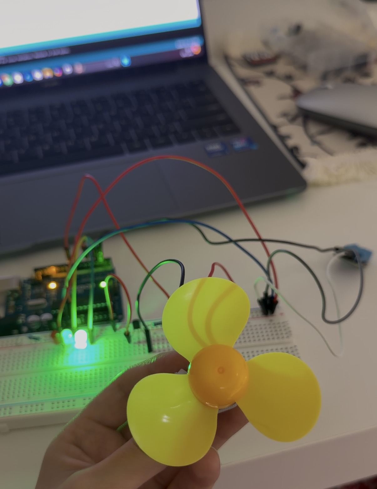
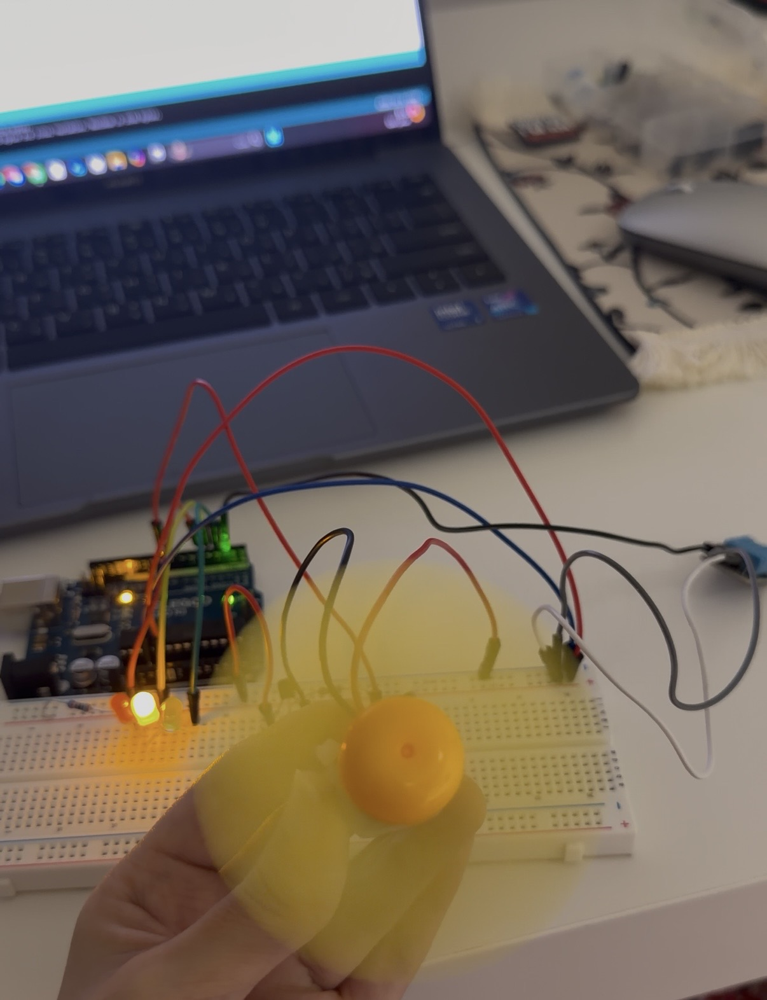

# Arduino-Based Smart Temperature-Controlled Fan

## Project Overview

This is one of my personal Arduino projects,
developed through self-learning and hands-on
experimentation.

The project demonstrates an automatic cooling
system that adjusts fan speed based on
temperature readings.

Using an Arduino and a DHT11 sensor, the system
monitors temperature and humidity while
controlling a fan and three LED indicators.

## How It Works

The DHT11 sensor measures the surrounding
temperature and humidity.

The Arduino processes the temperature readings
and automatically adjusts the fan speed using
Pulse Width Modulation (PWM).

### Temperature Levels

| Temperature | LED Indicator | Fan Operation |
|-------------|---------------|---------------|
| Below 25°C | Green | OFF |
| 25°C to below 30°C | Yellow | Medium Speed (~59% PWM) |
| 30°C and above | Red | Maximum Speed (100% PWM) |

When the temperature is below 25°C, the green
LED turns on and the fan remains off.

When the temperature reaches 25°C, the yellow
LED turns on and the fan operates at a moderate
speed.

At 30°C or higher, the red LED turns on and
the fan operates at maximum speed to provide
additional cooling.

## Additional Features

- Temperature and humidity monitoring.
- Automatic fan speed adjustment using PWM.
- Three LED indicators for temperature levels.
- Real-time data displayed on Serial Monitor.
- Sensor error detection with automatic
  fan shutdown.

## Components

- Arduino Board
- DHT11 Temperature and Humidity Sensor
- DC Fan Motor
- Green LED
- Yellow LED
- Red LED
- Breadboard
- Jumper Wires

## Skills Demonstrated

- Arduino Programming
- DHT11 Sensor Integration
- PWM-Based Motor Control
- Conditional Programming
- Sensor Data Monitoring
- Electronic Circuit Prototyping
- Hardware and Software Integration

## Project Evidence

Arduino source code and project photos demonstrate the practical implementation of this system.

### Normal Temperature Operation

[View Full Image](IMG_9016.jpeg)

### Moderate Temperature Operation

[View Full Image](IMG_9017.jpeg)
